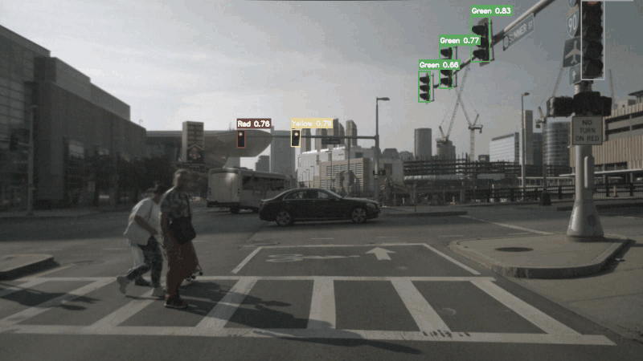

# nuscenes-traffic-lights

Pipeline that detects traffic lights on nuScenes front-camera images and labels their state as **Red / Yellow / Green / Unknown**.

Detection is done with YOLOv8. Color is decided with OpenCV (HSV). Results can be checked in FiftyOne.



**How to run:** [Local (venv)](#local-venv) · [Docker (GPU + FiftyOne)](#docker-gpu--fiftyone)

## Motivation

nuScenes is a driving dataset, but it does not give traffic light state labels. This project fills that gap so the labels can be used later for training a MoE model.

## How it works

1. Collect `CAM_FRONT` image paths from nuScenes mini
2. Run YOLO to find traffic lights
3. Crop each box and classify color with HSV thresholds
4. Export labels and open them in FiftyOne for a visual check

## Dataset (nuScenes mini)

Needed for both local and Docker runs.

1. Go to [nuscenes.org/download](https://www.nuscenes.org/download), log in, accept the terms
2. Download **v1.0-mini**
3. Unpack it into the project so it ends up here:

```text
data/nuscenes/sets/v1.0-mini/
  samples/
  sweeps/
  maps/
  v1.0-mini/
```

That path is already set in `traffic_lights/src/extract_paths.py`.

---

## Local (venv)

Default path: Python **3.12** + virtualenv on the host. No Docker required for the pipeline.

### Setup

```bash
make setup
```

That creates `.venv` and installs dependencies from `requirements.txt`. YOLO weights (`yolov8x.pt`) download on first detect run.

### Run

From the repo root (venv is used automatically via `.venv/bin/python`):

| Command | What it does |
|---------|----------------|
| `make setup` | Create venv + install deps |
| `make extract` | CAM_FRONT paths → `paths_for_samples.json` |
| `make detect` | YOLO + HSV → `boxes_dict.json` |
| `make export` | FiftyOne format → `boxes_dict_for_fiftyone.json` |
| `make vis` | Open FiftyOne App (needs a working MongoDB / `FIFTYONE_DATABASE_URI`) |
| `make gif` | 10 diverse frames → `assets/predictions_preview.gif` |
| `make pipeline` | `extract` → `detect` → `export` (no UI) |
| `make all` | Full pipeline + FiftyOne |
| `make clean` | Remove JSON outputs + `debug_unknown/` |
| `make help` | List targets |

Typical flow:

```bash
make setup
make pipeline   # or: make all
```

Make skips steps when output JSON is newer than its inputs. Source code lives in `traffic_lights/src/`; JSON outputs are written in the repo root.

> **FiftyOne locally:** the App needs MongoDB. Prefer the [Docker](#docker-gpu--fiftyone) `make docker-vis` path, or point `FIFTYONE_DATABASE_URI` at any MongoDB you already have. `make pipeline` does not need MongoDB.

---

## Docker (GPU + FiftyOne)

Same pipeline in containers. **Detect uses the GPU.**

### Host prerequisites

Install these yourself on the machine (not inside the project):

1. **Docker** + Compose plugin  
2. **NVIDIA driver** — `nvidia-smi` must work on the host  
3. **NVIDIA Container Toolkit** — so containers can see the GPU  

Quick GPU check after toolkit setup:

```bash
make docker-gpu-check
```

You should see your GPU listed. Put the dataset under `data/` as above; optional: keep `yolov8x.pt` in the repo root so weights are not re-downloaded.

### Commands

| Command | What it does |
|---------|----------------|
| `make docker-build` | Build the CUDA image |
| `make docker-pipeline` | `extract` → `detect` (GPU) → `export` |
| `make docker-vis` | Start Mongo + FiftyOne App → [http://localhost:5151](http://localhost:5151) |
| `make docker-down` | Stop Compose services |
| `make docker-shell` | Interactive shell in the GPU image |
| `make docker-gpu-check` | `nvidia-smi` inside a CUDA container |

Typical flow:

```bash
make docker-build
make docker-pipeline
make docker-vis
# browser → http://localhost:5151
# Ctrl+C when done, then:
make docker-down
```

Compose services (see `docker-compose.yml`):

| Service | Role |
|---------|------|
| `pipeline` | Full pipeline; `--gpus all` |
| `mongo` | Official `mongo:7` (data in a Docker volume) |
| `vis` | FiftyOne App on port **5151** (CPU only) |

The project directory is bind-mounted into the container, so JSON outputs and `debug_unknown/` appear on the host as usual. The host `.venv` is not used inside Docker.

---

## Stack

| Piece | Role |
|-------|------|
| Python 3.12 | Local runtime |
| [YOLOv8](https://github.com/ultralytics/ultralytics) (Ultralytics) | Traffic light detection |
| OpenCV | HSV color classification on crops |
| [nuScenes](https://www.nuscenes.org/) + devkit | Dataset + path extraction |
| FiftyOne | Visual QA of boxes and labels |
| Docker + NVIDIA Container Toolkit | Optional GPU pipeline + Mongo for FiftyOne |

## License

This repository’s **code** is under the [MIT License](LICENSE).

The **nuScenes** dataset is separate: download and use it only under [nuScenes’ own terms](https://www.nuscenes.org/terms-of-use). This project does not redistribute nuScenes data.
